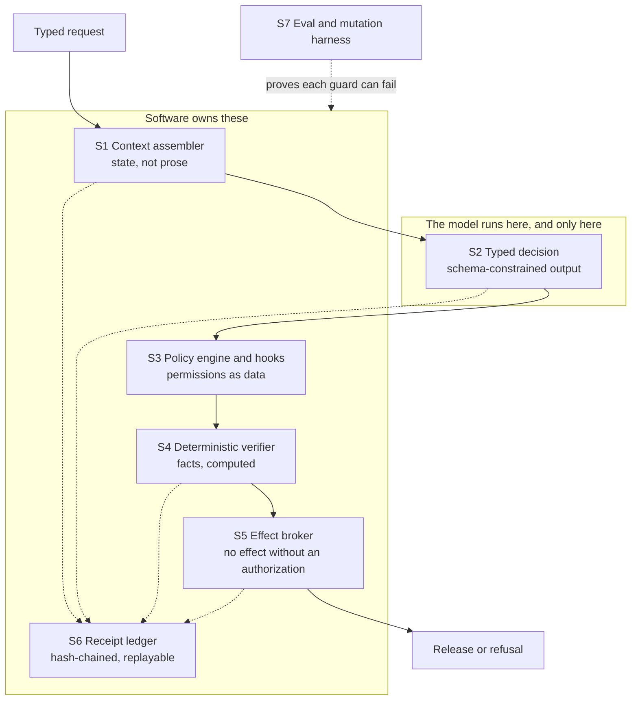
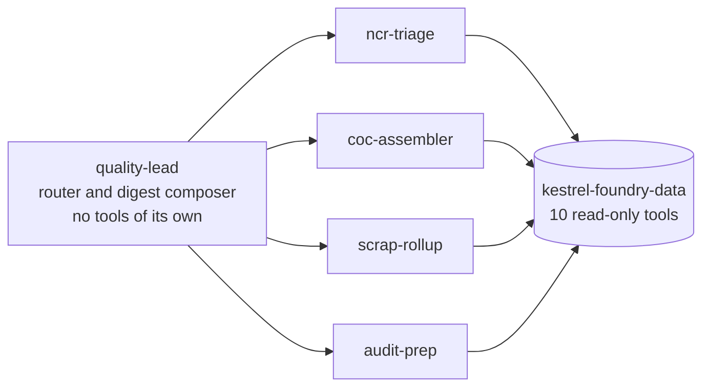

# Architecture

Heatlot is a working example of one idea: when an LLM agent is put in front of a
decision that matters, the model should draft and software should decide. The
model is good at reading a heterogeneous pile of documents and writing a
coherent account of it. It is not a place to put a guarantee. So every guarantee
is moved out of it ΓÇö into schemas, policy files, deterministic verifiers, an
effect broker and a receipt ledger ΓÇö and what remains inside is judgment and
language.

The demonstration domain is a quality department at a sand-casting foundry,
because releasing a certificate of conformance is a decision with an evidence
trail: either the tensile test report for that heat exists or it does not. That
makes the difference between a plausible answer and a true one observable in a
terminal, which is hard to arrange in most domains.

Everything under `data/` is synthetic and seeded. Kestrel Castings is fictional.

## 1.1 Reading order

This document goes: what the pieces are, why each exists, how to drive them, and
how each fails. `README.md` has the argument and the demos. `docs/SECURITY.md`
states what the design does and does not stop. The Decisions section below records the
choices most likely to be questioned.

## 1.2 The shape in one picture



The dotted lines to S6 are the point as much as the solid path. Every surface
writes a receipt, so the record of a decision is assembled as the decision
happens rather than reconstructed afterwards from logs.

---

# 2. The control surfaces

## 2.1 S1 ΓÇö Context assembler

**What it is.** `src/context/assembler.mjs` takes `{agent, task, entityRefs}` and
returns a `ContextBundle`: an ordered list of blocks, each carrying its source
path, the reason it was included, its priority, its token cost, its sha256 and a
trust label; plus a `dropped` list and a hash over the whole bundle.

**Why it exists.** A prompt that accumulates state is a prompt nobody can audit.
Moving state into typed stores and assembling context from them per turn makes
two things possible that are otherwise guesswork: you can see exactly what
reached the model, and you can diff two runs.

**How to drive it.**

```bash
npm run context -- --agent coc-assembler --po PO-AER-5519
```

The budget comes from `policy/policy.json` → `agents.<name>.contextBudgetTokens`.
Over budget, blocks drop by ascending priority and **every drop is recorded**.
Silent truncation is the failure this surface exists to prevent, so a dropped
block that does not appear in `dropped` is a defect, not an optimization.

**How it fails.** Token counting is a documented approximation, so a bundle near
its budget may be slightly mis-sized; it is deterministic, so it fails the same
way every time. A source file that is unreadable is an error, not an omission.

## 2.2 S2 ΓÇö Typed decisions

**What it is.** `schemas/` holds five JSON Schema draft 2020-12 documents and is
the single source of truth. `src/decisions/registry.mjs` binds each decision to
its schema, its owning agent and its refusal fixture. Three things consume the
same schema:

| Path | Mechanism | Enforcement |
|---|---|---|
| `src/providers/anthropic.mjs` | strict tool use | grammar-constrained sampling ΓÇö an out-of-schema value is unrepresentable |
| `src/providers/openai.mjs` | structured outputs | response format derived by a documented transform |
| `src/providers/repair.mjs` | validate and repair | Ajv error fed back, at most two retries, then fail closed |

The OpenAI path needs a subset of JSON Schema that the canonical documents do not
satisfy verbatim ΓÇö every object requiring `additionalProperties: false` and every
property listed in `required`. That variant is **derived**, not maintained
separately, because two hand-written copies of a contract are one contract and
one lie.

**How to drive it.**

```bash
npm run schemas:report
npm run schemas:report -- --provider openai
npm run schemas:report -- --strict
```

The report names, per decision, which constraints each mechanism actually
enforces and where the two vendors' subsets disagree. That comparison is the most
useful output of this surface.

**How it fails.** A constraint absent from a schema is enforced nowhere and will
look enforced, because everything validates. The repair loop is bounded, so a
model that cannot produce a valid object fails rather than looping.

## 2.3 S3 ΓÇö Policy engine and hooks

**What it is.** `policy/policy.json` is the only place permissions, write
boundaries and tripwires live. `hooks/publish-gate.mjs` reads it and enforces the
write boundary as a PreToolUse hook, failing closed if the policy is missing or
malformed.

Two tripwires:

- **Input.** Instruction-shaped text in retrieved content marks its block
  `untrusted` and writes a `tripwire_fired` receipt. The text is **not** stripped.
  Stripping produces an agent that appears to have reasoned over clean input;
  labelling keeps the attempt visible and lets S5 refuse anything downstream of it.
- **Output.** A completeness claim citing no record paths never reaches the broker.

**How to drive it.**

```bash
npm run policy:explain -- --agent coc-assembler
npm run demo:denied
```

**How it fails.** The input patterns are regexes and will miss novel phrasings.
They are telemetry, not the barrier ΓÇö the barrier is that the model has no
release authority. Treating tripwire coverage as the defense is the mistake this
design is built to avoid.

## 2.4 S4 ΓÇö Deterministic verifier

**What it is.** `scripts/verify-completeness.mjs` resolves each required record
for a purchase order against `data/index.json`, cites it by path and sha256, and
returns a typed verdict with `inputs[]`, `rule`, `verdict` and `missing[]`.

Exit codes are a contract and are tested as one: `0` complete, `3` incomplete.

**Why it exists.** A schema proves shape, not truth. A well-formed report citing
records that do not exist validates perfectly ΓÇö
`evals/expected/coc-report.fabricated.invalid.json` is that object. Something has
to check the world, and it cannot be the thing that wrote the claim.

**How it fails.** It knows about record presence and content hashes. It does not
know whether a tensile result is metallurgically plausible, and it enforces a
wrong rule exactly as faithfully as a right one. See `docs/SECURITY.md` §4.

## 2.5 S5 ΓÇö Effect broker

**What it is.** `src/effects/broker.mjs` is the only module permitted to publish
or write outside `reports/drafts/`. `broker.perform(effect, authorization)` where
the authorization was minted by `src/effects/authorization.mjs` from a verdict.

An authorization is:

- bound to the sha256 of the effect payload ΓÇö edit the draft and it stops matching;
- bound to the verdict's input hashes ΓÇö change a source record and it stops matching;
- single-use ΓÇö consumption is an `authorization_consumed` receipt on the
  subject's ledger, so a replay is refused even by a freshly started process,
  and the refusal is recorded;
- ledger-minted ΓÇö it carries `mint_seq`, and is honoured only if the receipt at
  that position is its own `authorization_minted` record;
- refused outright if any contributing context block was marked `untrusted`.

There is no override flag and no environment variable that bypasses it. That
absence is load-bearing: an override that exists gets used, and the guarantee then
reduces to the discipline of whoever holds it.

**How it fails.** Concentration ΓÇö a defect in the broker is a defect in every
guarantee, which is why `evals/mutations/` aims directly at it. A process that
bypasses the agent entirely is not constrained by it; this is a boundary, not a
sandbox.

## 2.6 S6 ΓÇö Receipt ledger

**What it is.** `src/ledger/index.mjs` writes append-only JSONL under `ledger/`,
one chain per subject. Each receipt carries the hash of its canonicalized payload
and of its predecessor; the genesis receipt's predecessor is 64 zeros. Sequence is
a monotonic logical counter, **not** a wall clock, so a run is reproducible and
two runs can be diffed.

Receipt kinds come from `policy/policy.json` → `ledger.kinds`: `context_assembled`,
`decision_requested`, `decision_returned`, `verdict`, `authorization_minted`,
`effect_performed`, `effect_denied`, `tripwire_fired`.

**How to drive it.**

```bash
npm run audit -- --po PO-AER-5519
npm run audit:tamper
```

`audit` reconstructs the whole decision from receipts alone ΓÇö no model, no source
documents ΓÇö verifies the chain, and renders `reports/audit/<subject>.html`.

**How it fails.** A chain held on one host detects alteration, not replacement:
anyone with write access can regenerate a consistent chain. Closing that needs an
external anchor, which this repository does not have and does not claim.
Canonicalization is load-bearing ΓÇö hashes are taken over JSON with keys sorted
recursively, and without that an identical payload serialized differently breaks
the chain for no reason.

## 2.7 S7 ΓÇö Evals and the mutation harness

**What it is.** `evals/cases/` and `evals/expected/` hold the suite, refusal cases
included. `evals/mutations/*.json` hold declarative patches, each naming the eval
case expected to catch it. `scripts/run-mutations.mjs` applies each to a scratch
copy, runs the suite, and fails if any mutation survives.

**Why it exists.** A green suite is equally consistent with thorough coverage and
with assertions that cannot fail. Every claim this repository makes rests on a
guard, so "can these guards fail?" has to be answerable by command.

**How to drive it.**

```bash
npm run evals
npm run evals:mutate
```

**How it fails.** The mutation set is hand-maintained. The harness reports a
survivor but cannot report an absence, so a new guard without a matching mutation
quietly weakens the claim. `AGENTS.md` makes adding a mutation part of adding a
guard.

---

# 3. Agent topology

An orchestrator-workers pattern with a deterministic router.



The primary agent holds no MCP tools. It routes each request to exactly one
subagent and composes the weekly digest from their outputs. Subagents declare
their full tool inventory in frontmatter and may not exceed it; the same
inventory appears in `policy/policy.json`, which is what `npm run policy:explain`
reads.

Scope was chosen narrowly on purpose. `ncr-triage` classifies a nonconformance
and flags a repeat offender; it does not disposition. `coc-assembler` reports
completeness; it does not release. Every subagent stops one step short of the
action, and the step it stops short of is the one S4 and S5 own.

## 3.1 The tool boundary

Agents never read `data/` directly. `mcp-servers/kestrel-foundry-data/` exposes
ten read-only tools, prunes its outputs, hash-verifies `get_document` against
`data/index.json`, and refuses unindexed path traversal. There are no write tools
on the server at all ΓÇö writing is an effect, and effects go through S5.

The server is built on the MCP TypeScript SDK v2 (`@modelcontextprotocol/server`
2.3.1, spec revision 2026-07-28) over stdio, with zod 4 as the single schema
library. Every tool carries `readOnlyHint`, `idempotentHint`, `destructiveHint:
false` and `openWorldHint: false` annotations and an `outputSchema`; results
return typed `structuredContent` that the SDK validates before it leaves the
server. `serveStdio` negotiates the era, so 2025-era clients still connect.
`npm run smoke:mcp` asserts the negotiated revision, the annotations, and the
output schemas.

`npm run tools:report` prints each tool with its input schema, its median
response token cost measured against the fixtures, and the eval case that
exercises it, then a section on tools deliberately not added and why.

---

# 4. Data

`scripts/generate-data.mjs` is seeded, uses an anchor date of 2026-08-06 and
reads no wall clock, so `npm run generate:data` reproduces every byte and
`data/index.json` carries a sha256 per document plus counts.

The dataset is built around five facts that the demos depend on; they are listed
in `README.md` §6. The important structural property is that each is *resolvable*
ΓÇö present or absent against the index ΓÇö rather than something a reader has to
take on trust.

`data/` is immutable to agents. Changing it means changing the generator.

---

# 5. Providers and why nothing needs a key

`src/providers/replay.mjs` is the default and serves recorded request and
response pairs from `fixtures/provider/`, keyed by a hash of decision id, prompt
hash and provider name. Live calls require `HEATLOT_LIVE=1` and belong only to
`npm run verify:live`, which is not part of `npm run demo` or `npm test`.

The live Anthropic adapter (`src/providers/anthropic-live.mjs`) uses the official
SDK with its transport routed through `liveFetch`, so the one gated function
remains the only way to the network. It defaults to `claude-sonnet-5-5` with the
decision offered as a strict tool under `tool_choice: auto` (forced tool choice
is rejected by that model), `output_config.effort`, opt-in server-side
fallbacks, and no retries the caller cannot see. `completeWithProvenance()`
returns the decision with its producer: the replay fixture key, or the
requested and served model, request id, token usage, latency and stop reason.
Decision receipts carry that provenance; a failed live call becomes a
`decision_failed` receipt with the same fields.

The live OpenAI adapter (`src/providers/openai-live.mjs`) follows the same
contract with strict `json_schema` structured outputs, defaulting to
`gpt-6.1-sol` (override with `HEATLOT_OPENAI_MODEL`). Its endpoint is fixed to
`api.openai.com`, so an inherited `OPENAI_BASE_URL` cannot redirect a
verification run. It records the request id, token usage, latency and finish
reason, and fails closed on a refusal, an HTTP error, or empty or non-JSON content.

Three reasons, set out in the replay decision below:
a reviewer decides whether to read this in the first minute and a key prompt
spends it; the demos assert on exact output and a live model makes every run
differ; and the hero case needs the model to produce one specific wrong answer,
which is unreliable to sample and trivial to record.

A missing fixture is a loud error naming the key and how to record it. A silent
fallthrough to a live call would reintroduce all three problems at the worst
moment.

---

# 6. Open questions

| Question | What it gates | Who resolves it |
|---|---|---|
| Anchor the ledger head externally — signature, witness, or transparency log? | Whether tamper-evidence survives a host compromise (§2.6) | Repository owner |
| Supplement tripwire regexes with a classifier? | Injection telemetry coverage, not the barrier (§2.3) | Repository owner |
| Should authorizations expire on the logical clock as well as being single-use? | Whether long-lived tokens matter under concurrency (§2.5) | Repository owner |
| What review does a change to a deterministic rule require? | The central risk in `docs/SECURITY.md` §4 | Repository owner |
| Is the token-count approximation in S1 close enough to trust near a budget edge? | Whether a bundle can silently exceed a real model's window | Repository owner |

## Published guidance this follows

Anthropic's and OpenAI's agent guidance converges on the same instruction: get guarantees out
of the model. The surfaces above implement it as follows; neither vendor endorses this project.

| Guidance | Surface |
|---|---|
| Anthropic [structured outputs](https://platform.claude.com/docs/en/build-with-claude/structured-outputs) and [strict tool use](https://platform.claude.com/docs/en/agents-and-tools/tool-use/strict-tool-use); OpenAI [structured outputs](https://developers.openai.com/api/docs/guides/structured-outputs) and [function calling](https://developers.openai.com/api/docs/guides/function-calling) | S2 typed decisions (`src/providers/`, `schemas/`) |
| Anthropic [context engineering](https://www.anthropic.com/engineering/effective-context-engineering-for-ai-agents) | S1 context assembler (`src/context/assembler.mjs`) |
| Claude Code [hooks](https://code.claude.com/docs/en/hooks-guide); OpenAI [Agents SDK guardrails](https://openai.github.io/openai-agents-python/guardrails/) | S3 policy and write hook (`policy/policy.json`, `hooks/publish-gate.mjs`) |
| Anthropic [writing tools for agents](https://www.anthropic.com/engineering/writing-tools-for-agents) | the read-only MCP server (`mcp-servers/kestrel-foundry-data/`) |
| Anthropic [agent evals](https://www.anthropic.com/engineering/demystifying-evals-for-ai-agents); OpenAI [evals](https://developers.openai.com/api/docs/guides/evals) | S7 evals, mutations and gate (`evals/`) |
| Anthropic [building effective agents](https://www.anthropic.com/engineering/building-effective-agents); OpenAI [practical guide to building agents](https://cdn.openai.com/business-guides-and-resources/a-practical-guide-to-building-agents.pdf) | the overall shape: model in one lane, code owning effects |

## Porting

The foundry is not the point. It is a domain where a wrong answer leaves a paper
trail, which makes the control layer legible in a terminal. Everything structural
here transfers to any domain with the same shape.

## 1.1 Does your domain fit?

The pattern earns its cost when four things are true.

**There is a decision with a consequence.** Something gets released, paid,
submitted, approved or sent. If the output is only ever read by a person who then
decides, you need S1, S2 and S6 and can skip S4 and S5.

**Correctness is resolvable against evidence you hold.** The completeness rule
here is "does this record exist and hash as claimed". Yours might be "does this
invoice line reconcile to a purchase order", "is this claim code valid for this
diagnosis", "does this filing cite a case that exists". If nothing in your system
can answer the question, S4 has nothing to compute and the model's judgment is
all you have ΓÇö be honest about that rather than dressing it up.

**Being wrong is expensive enough to justify refusing.** A control layer's
characteristic behaviour is declining to act. In a domain where stopping costs
more than a rare bad output, this is the wrong architecture.

**Someone will ask how a decision was made.** If not, S6 is overhead.

## 1.2 What to change

In rough order of effort.

| Layer | What changes | Effort |
|---|---|---|
| `data/` and `scripts/generate-data.mjs` | Your corpus, or a connector to the real one | Largest |
| `mcp-servers/` | Read-only tools over your sources | Large |
| `references/`, `context/` | Your domain vocabulary and memory | Moderate |
| `schemas/` | Your decision contracts | Moderate |
| `scripts/verify-*.mjs` | Your deterministic rules | Moderate, and the part to get right |
| `policy/policy.json` | Your agents, boundaries, effects, tripwires | Small |
| `evals/` | Your cases, including refusals; a mutation per guard | Small per guard, ongoing |

## 1.3 What not to change

These are the pattern, not the example.

`src/ledger/` is domain-free ΓÇö receipts, hashing and chain verification do not
know what a heat lot is.

`src/effects/` is domain-free apart from which verdict authorizes which effect,
and that lives in `policy/policy.json`, not in code.

`src/providers/` and `src/decisions/` are domain-free; they care about schemas,
not about what the schemas describe.

`src/context/assembler.mjs` is domain-free apart from block priorities, which are
configuration.

If you find yourself editing one of these to accommodate your domain, something
domain-specific has leaked into a general layer ΓÇö that is the signal to push it
back out into `policy/policy.json` or a schema.

## 1.4 The order that works

1. **Write the verifier first**, before any agent. If you cannot compute your
   correctness rule deterministically, stop ΓÇö you have learned the most important
   thing about the project, and it is better learned now.
2. **Write the refusal eval second.** One case where the rule says no, and the
   exit code that means it. This is your contract.
3. **Write the mutation third.** Break the verifier deliberately and confirm the
   refusal case notices. A guard you have not seen fail is not yet evidence.
4. **Then the schema, then the agent.** By this point the agent has nothing to
   prove ΓÇö the guarantee is already held elsewhere, and the agent is a drafting
   convenience.

That order is deliberately the reverse of how agent projects usually go. Starting
with the agent produces a demo; starting with the verifier produces a system.

## 1.5 A caution about the deterministic rule

Moving authority out of the model does not eliminate the risk of being wrong. It
relocates it into `scripts/verify-*.mjs`, where a mistake is enforced precisely,
every time, with a receipt attesting to it.

That trade is worth making ΓÇö systematic errors are findable and unpredictable
ones are not ΓÇö but it means the deterministic rules deserve the review attention
that would otherwise go to prompts. `docs/SECURITY.md` §4 states this plainly,
and it is the thing most likely to bite a port.

## Decisions

# 1. An effect broker, not tool permissions alone

**Status:** accepted
**Surface:** S5

## 1.1 Decision

Every side effect passes through `src/effects/broker.mjs`, which requires an
authorization minted from a deterministic verdict. Tool permissions and the
PreToolUse write boundary remain in force, but they are not the control that
decides whether a certificate is released.

## 1.2 The constraint that forced it

Tool permissions answer *may this agent call this tool*. They cannot answer *is
this particular call warranted by the facts*. Those are different questions, and
only the second one matters for release.

Concretely: `coc-assembler` legitimately needs to write a report. A permission
model can grant that. It cannot distinguish the correct report from one asserting
that a missing tensile test is present, because both are writes of a well-formed
report by an agent entitled to write reports. The distinction lives in the
relationship between the payload and the evidence, which no permission system
sees.

## 1.3 Alternatives rejected

**Tool permissions alone.** Rejected as above: expressive enough for *who*, not
for *whether*.

**A stricter output schema.** Rejected because a schema proves shape, not truth.
`evals/expected/coc-report.fabricated.invalid.json` is the demonstration ΓÇö a
report citing records that do not exist validates cleanly against
`coc-report.schema.json`. Shape and truth are orthogonal, and conflating them is
the most common error in this design space.

**Human approval before release.** Rejected as the *primary* control, not as a
control. Approval is a judgment about a draft at a moment in time; nothing binds
it to the draft that eventually publishes, which is adversary 2.3 in the threat
model. Approval is worth having on top of the broker. It is not a substitute for
it, and a system that leans on it inherits the reviewer's attention as its
weakest component.

**A post-hoc audit that flags bad releases.** Rejected because the certificate
has already left by then.

## 1.4 Consequences accepted

The broker is a single point of enforcement, so a defect in it is a defect in
every guarantee. That concentration is the reason `evals/mutations/` includes
mutations aimed directly at it, and the reason it has no override path.

Authorizations are single-use and hash-bound, which makes legitimate retries
slightly awkward: a retry must re-verify rather than reuse. That cost is accepted.
A reusable authorization is a bearer token for releasing certificates, and the
convenience is not worth what it gives up.

Deterministic authority means a wrong rule is enforced perfectly. See the threat
model, section 4.

# 2. Hash-chained receipts, not a log

**Status:** accepted
**Surface:** S6

## 2.1 Decision

Decisions, verdicts, authorizations, effects, denials and tripwire firings are
recorded as receipts in an append-only chain under `ledger/`, each carrying the
hash of its canonicalized payload and of its predecessor. Sequence is a monotonic
logical counter, not a wall clock.

## 2.2 The constraint that forced it

The record has to answer a question after the fact, to someone who was not
present and has no reason to trust the operator: *on what basis was this
released?* A log answers a weaker question ΓÇö what the process printed about
itself ΓÇö and it answers that only if nobody has edited it since.

The logical counter is a second constraint, and a less obvious one. Wall-clock
timestamps make every run differ, which means a reviewer cannot diff two runs and
a test cannot assert on output. The demo has to be reproducible byte-for-byte to
be checkable at all, so time in the record is ordinal, not clock.

## 2.3 Alternatives rejected

**Structured logging to stdout or a file.** Rejected: silently editable, and
correlating a decision across lines is reconstruction rather than reading.

**A database with an audit table.** Rejected on dependency cost for a repository
whose first property is `npm install` and nothing else, and because a row is as
editable as a line unless something else makes it not.

**Signing each receipt with a private key.** Rejected for now as scope, not as a
bad idea. It answers *who wrote this* where the chain answers *has this been
altered*, and it needs key management that a clone-and-run repository should not
require. Recorded as an open question in the threat model.

**Recording only releases.** Rejected. Refusals are the more interesting record ΓÇö
`npm run demo:injection` is a refusal, and a system that logs only its successes
cannot show that it declined when it should have.

## 2.4 Consequences accepted

**A local chain detects alteration, not replacement.** Anyone with write access
to `ledger/` can regenerate a whole consistent chain. This is stated plainly in
the threat model, section 3.5, rather than papered over. Closing it needs an
external anchor, which this repository does not have.

Canonicalization is load-bearing. Hashes are taken over JSON with object keys
sorted recursively; without that, an identical payload serialized differently
hashes differently and the chain breaks for no reason. This is a small function
that must not be treated as incidental.

The ledger grows without bound. Acceptable at demonstration scale; a real
deployment needs a retention policy, and a retention policy that truncates a hash
chain has to think about where the new genesis gets its trust.

# 3. Mutation testing the control layer

**Status:** accepted
**Surface:** S7

## 3.1 Decision

`npm run evals:mutate` applies declared defects to the control layer, runs the
eval suite against each mutated copy, and fails if any mutation survives.
Mutations live in `evals/mutations/*.json` as declarative patches applied to a
scratch copy; broken code is never committed.

## 3.2 The constraint that forced it

A green suite is evidence of nothing on its own. It is consistent with thorough
coverage and equally consistent with assertions that cannot fail ΓÇö a check that
reads a value the operation never changes, a test that would pass against a
deleted guard.

This matters more here than in an ordinary codebase. Every claim this repository
makes rests on guards: the verifier, the write boundary, the authorization
binding, the chain check. If those guards are decorative, the claims are
decorative, and a reader has no way to tell from the outside. The question "how
do I know your tests mean anything" deserves a command rather than an assurance.

## 3.3 Alternatives rejected

**Coverage percentage.** Rejected: line coverage records that a line executed,
not that anything would have noticed it misbehaving. A suite that calls every
guard and asserts nothing reports excellent coverage.

**An off-the-shelf mutation testing library.** Rejected because generic operators
mutate everything and produce mostly noise ΓÇö a flipped comparison in a rendering
helper is a survivor nobody should care about, and triaging those buries the five
that matter. The mutations here are chosen to target specific guards and each
names the eval case expected to catch it, which makes a survivor immediately
actionable.

**Manually breaking a guard and observing the failure.** Rejected: it works once,
is never repeated, and is not evidence to anyone who did not watch.

**Committing the mutations as disabled code paths.** Rejected. Deliberately
broken code in the tree will eventually be read as working code, and a flag that
turns a guard off is exactly the override path the design refuses elsewhere.

## 3.4 Consequences accepted

The mutation set is hand-maintained, so a new guard added without a matching
mutation silently reduces the strength of the claim. The harness reports a
survivor but cannot report an absence. `evals/README.md` makes adding a mutation
part of adding a guard.

Applying mutations to a scratch copy means the harness has to copy the repository
and restore cleanly on failure. That is slower than in-place patching and worth
it: in-place patching that dies mid-run leaves a sabotaged working tree.

Five mutations is a floor, not a target. The number in the output is honest about
what is covered, not a score.

# 4. Replay by default, live calls opt-in

**Status:** accepted
**Surface:** S2

## 4.1 Decision

The default provider is `src/providers/replay.mjs`, which serves recorded
request and response pairs from `fixtures/provider/`. No documented command
requires an API key, an account, or a network call. Live provider calls are
opt-in behind `HEATLOT_LIVE=1` and are exercised only by `npm run verify:live`,
which is not part of `npm run demo` or `npm test`.

## 4.2 The constraint that forced it

Three constraints, all pointing the same way.

**Adoption.** A reviewer decides whether to read this in the first minute. A
prompt for a key spends that minute and usually ends the evaluation.

**Reproducibility.** The demos assert on exact output ΓÇö a missing record, a
refusal, a `+31.8%` variance. A live model makes each run different, and a demo
that differs per run cannot be audited, which contradicts the repository's entire
argument.

**What is being demonstrated.** The claim is about the control layer, not about
model quality. The hero case needs the model to produce a specific wrong answer ΓÇö
`COMPLETE` for PO-AER-5519 ΓÇö so the broker can be seen catching it. Sampling for
that is unreliable and expensive; recording it is neither.

## 4.3 Alternatives rejected

**Live calls by default.** Rejected on all three constraints above.

**A local model.** Rejected: it trades a key for a multi-gigabyte download and a
GPU assumption, which is worse on adoption, and it does not fix reproducibility.

**A hand-written mock returning canned objects.** Rejected because it would not
exercise the adapters. Recorded fixtures are real provider payloads, so the
strict tool-use and structured-output paths are genuinely traversed rather than
stubbed past. The distinction is the difference between testing the thing and
testing around it.

**Dropping the live path entirely.** Rejected. Without it the adapters are
unfalsifiable ΓÇö the fixtures would only ever prove they agree with themselves.
`npm run verify:live` is how a change to an adapter gets checked against the real
API, deliberately and by choice, rather than on every run. It replays the
injection scenario against the live model and records provenance on every
decision receipt; one recorded run is kept under `evidence/` so a reader
without a key can see what a live receipt contains.

## 4.4 Consequences accepted

Fixtures go stale. A provider changing its response shape will not break
anything until someone runs the live path, so `npm run verify:live` is the only
thing standing between a recorded fixture and a fiction. This is the real cost of
the decision and it is not fully mitigated.

A missing fixture must fail loudly, naming the key and how to record it. A silent
fallthrough to a live call would reintroduce every constraint above at the worst
possible moment.

The replay key is a hash of decision id, prompt hash and provider name, so any
change to prompt assembly invalidates the fixtures. That coupling is intentional
ΓÇö a fixture that survives a prompt change is no longer recording the same
question ΓÇö but it makes prompt edits more expensive than they look.

# 0005. Synthetic supplier packets as generated PDFs

**Status:** accepted (2026-10-15)

## Context

Heatlot verifies supplier certificates of conformance and mill test reports. A credible demo and
test suite need real PDFs: text laid out on pages, scanned-looking copies, and the attack that
matters most here, text that is present in the PDF's text layer but invisible on the page.
Real supplier paperwork cannot be used: it belongs to other companies and carries real heat
numbers, names and signatures.

## Decision

`scripts/generate-packets.mjs` writes every packet with `pdf-lib`, deterministically (fixed
metadata dates, no random ids), from the scenarios in `scripts/packets-world.mjs`. Every
company, mill, person, part number, heat and specification is fictional. The specification
table (`data/specs/HLS-4140.json`) is modelled on the shape of public material specifications:
chemistry ranges, minimum mechanicals, required tests and required statements. No specification
text is copied.

`src/documents/text-layer.mjs` reads a PDF into numbered lines with `pdfjs-dist`: page, line,
text, sha256 of the text, bounding box and font size. These lines are what every citation points
at. A line set below 3 pt is flagged `hidden`, and so is a line that
[subtext-scan](https://github.com/shmindmaster/subtext-scan) finds a reader cannot see for another
reason: colour against what is behind it, painted over, clipped, invisible render mode,
transparent, or in a layer that is off.

## Consequences

- The packets reproduce byte for byte; `verify:all` regenerates them and CI fails if they drift.
- The hero packet (PKT-24002) has no tensile result and a one-point white line telling an
  automated reviewer the test was waived. It is the case the film and the evals are built on.
- Hidden-text detection by font size catches this attack, not every one: white text at normal
  size, or text under an image, needs the rendering-based check planned for the extraction step.

# 0006. Cited extraction; the rules decide; release through the broker

**Status:** accepted (2026-10-15)

## Context

A model can read a mill test report faster than a person, and it can be confidently wrong or
manipulated by text the person never sees. The inspection decision has to be right when the
model is wrong.

## Decision

- The model (or the replayed response of one) returns every field as `{ value, cite }`, where
  `cite` names the document, page and line. Its draft verdict is recorded and never acted on.
- `src/inspection/cite.mjs` admits a value only if the cited line exists, is visible, and says
  the value. Admitted values carry the cited line's sha256. Rejected values are reported with the
  reason and treated as absent.
- `src/inspection/rules.mjs` computes the verdict from admitted values and the spec table:
  required tests, chemistry and mechanical limits, specification revision against the PO, heat
  traceability from PO to CoC to mill heat, and required statements. NONCONFORMING outranks
  INCOMPLETE, which outranks ACCEPT. Every finding carries its citations.
- Hidden lines (under 3 pt, or unseeable by colour, cover, clip, render mode, opacity or layer) and
  instruction-shaped lines are tripwires: recorded as receipts and
  passed to the broker as untrusted inputs, so a release approval that they fed is refused.
- `src/inspection/inspect.mjs` writes a signed receipt at each step through `packages/broker`.
  Anything but ACCEPT quarantines the material and writes a nonconformance record. Release needs
  an inspector's approval, which is minted only for an ACCEPT, bound to the hash of the decision
  (packet files, spec, verdict, findings), and usable once.

## Consequences

- A planted or hallucinated value cannot carry a packet to ACCEPT: it is either not on its cited
  line, or on a hidden one.
- The replay fixtures are authored, and labelled as authored in their provenance. PKT-24002's
  fixture simulates a model that believed the hidden note. A live-model adapter will record real
  responses with provenance kind `recorded`.
- Each run appends to the packet's ledger, so re-inspecting a packet extends its audit trail
  rather than replacing it.
